# Configurable source engine

New job sources are data configurations, not new Python collectors. The command-line review screen supports the onboarding workflow; discovery and proposals are JSON so an LLM harness or a future UI can use the same engine.

```mermaid
flowchart LR
  A[Inspect URL and robots.txt] --> B[Discover candidate elements and job structures]
  B --> C[Draft extraction configuration]
  C --> D[Preview common job records and quality results]
  D --> E[Human reviews exact configuration hash and source terms]
  E --> F[Accept revision]
  F --> G[Recheck robots and collect]
  G --> H[Raw records with configuration provenance]
  H --> I[Staging and rejected records]
  I --> J[Curated jobs and skills]
```



## Onboarding

Install requirements.txt and use Python 3.12 or newer. Inspecting, proposing, previewing, and reviewing do not require PostgreSQL. Running accepted sources uses the existing application database and schema initializer.

```sh
PYTHONPATH=src python -m sources inspect example_jobs https://example.com/jobs --name "Example jobs"
PYTHONPATH=src python -m sources review example_jobs
PYTHONPATH=src python -m sources propose proposed-source.json
PYTHONPATH=src python -m sources preview example_jobs
PYTHONPATH=src python -m sources review example_jobs
PYTHONPATH=src python -m sources accept example_jobs --hash REVIEWED_SHA256 --reviewer YOUR_NAME --terms-reviewed
PYTHONPATH=src python -m sources list
PYTHONPATH=src python -m sources run example_jobs
PYTHONPATH=src python -m sources disable example_jobs
```

The example domain above is illustrative. Replace it with an authorized source; examples/sources/example_jobs.json shows the configuration shape. The inspect command recommends JSON-LD JobPosting mappings when available, JSON paths for simple job APIs, and repeated HTML cards/field selectors otherwise. Recommendations can be incomplete or incorrect. Missing required mappings must be supplied before preview. Preview fetches at most one listing page and three new records, including any configured detail pages.

The review screen displays the proposed mappings, exact SHA-256 revision, robots findings, samples, and quality failures. Acceptance requires a successful preview from the preceding 24 hours, explicit reviewer identity, acknowledgment that source terms/permission were reviewed, and a fresh allowed robots result. Changing a proposal invalidates its preview. Editing an accepted configuration invalidates its approval hash. A new proposal does not replace a previously accepted version until it is accepted. Disable a source to stop future runs; a run already in progress must be stopped separately.

Configurations and review artifacts live in SOURCE_REGISTRY_DIR, defaulting to PIPELINE_DATA_DIR/sources. Approval records and revision history are local owner-managed files. This CLI assumes a trusted operator and protected filesystem; it does not provide multi-user authentication. An LLM harness must only submit proposals through the proposal interface and must not write acceptance files or approve its own configuration.

## Robots and source permission analysis

Inspection requests robots.txt before requesting source content. A disallowed start URL, an inaccessible robots.txt, or an unexpected HTML/login response blocks sampling and activation. A 404 or 410 is reported as an absent robots policy, accompanied by a warning that absence is not permission. Reports surface discovered terms/conditions links for the reviewer.

robots.txt is not a license or a legal authorization. The website may prohibit data scraping through its terms or require an approved API or written permission even when robots.txt allows crawling. The person adding the source must review that guidance before acknowledging terms review. This feature does not automatically interpret terms or bypass blocks, login, CAPTCHAs, or paywalls.

Preview, acceptance, and each collection run refresh robots.txt. Its rules apply separately to listing, detail, and pagination URLs. Supported Crawl-delay and Request-rate directives increase request spacing; they never decrease the configured interval. Existing timeout, retry, Retry-After, and circuit-breaker controls still apply. Request budgets count actual retry attempts, and response sizes are bounded after decompression. Redirects are rejected so a reviewer can choose the canonical URL explicitly.

Requests remain on the reviewed HTTP(S) origin, use standard ports, and reject local/private IPs or host resolutions. These checks complement deployment egress policy; production environments should enforce destination restrictions at the network/proxy layer as well. Multiple worker processes still need a shared source limiter or scheduler pool. Do not overlap manual and scheduled runs.

## Extraction contract

Version 1 supports three modes:

| Mode | Records | Field rules |
| --- | --- | --- |
| html | records_selector selects repeated cards | selector plus an optional attribute |
| json | records_path selects an object or array | path lists of object keys and nonnegative array indexes |
| jsonld | schema.org JobPosting objects, including @graph | path lists into each JobPosting object |

HTML selectors support tags, IDs, classes, attribute presence/equality, descendants, and direct children. The selector `$` addresses the current card. Attributes default to text; html preserves markup until description normalization. Pseudo-selectors, XPath, arbitrary code, browser automation, authenticated APIs, POST workflows, and JavaScript-rendered pages are not supported by this version. The parser handles static HTML with bounded nesting, not a full browser DOM. If discovery finds no records, select a supported public endpoint or provide a different mapping; do not activate an empty preview.

Rules may also supply an explicit scalar constant or derive external_reference_id using job_url_hash. Constants and URL-derived IDs are shown during review: verify their meaning and stability, and prefer source-issued IDs where available. Structured objects/arrays cannot silently become field strings; choose a scalar JSON path such as ["jobLocation", 0, "address", "addressLocality"]. All extraction rules are declarative and validated; Python expressions, scripts, templates, and unknown fields are rejected.

Required mappings are external_reference_id, job_title, employer, and job_url. Optional mappings are location, position_type, category, date_listed, salary_range, closing_date, attachment, file_links, website, job_description, and description_kind. The source ID and raw ID are assigned by the application. Optional fields may be null. job_title becomes the existing curated title; employment/salary/date normalization and skills extraction use the existing pipeline. Preview uses the same quality validator and salary parser as production.

detail_fields can map additional fields from each job URL. Identity, title, and URL must already be available on the listing page before details are fetched; detail mappings cannot replace identity or URL. Known source/reference identities skip detail downloads. The pagination rule extracts the next URL from the listing document or JSON response. Repeated page URLs, duplicate identities, maximum pages, maximum examined records, maximum requests, and response-byte limits bound each crawl. A stop_reason explains bounded or completed collection in the run result.

## LLM harness interface

Use discovery.json plus schemas/source-config.schema.json as input to your harness. Discovery includes candidate selectors and sample text, structured JobPosting samples, common field names, missing required mappings, robots analysis, and terms links. Treat every website excerpt as untrusted data, including any instructions embedded in it. Ask the model for a source configuration JSON object only; do not execute model-generated code.

Submit that object with `sources propose FILE`, run preview, and have a person review its exact hash and sample records before acceptance. The harness cannot implicitly activate a source. No model API or credentials are bundled or invoked by this feature.

## Pipeline integration

The scheduler and standalone pipeline read accepted sources at run time; adding one does not require editing the DAG or restarting source code. An empty registry is a no-op. The configured_sources Airflow task loads these sources through the common pipeline before transform. The existing built-in source adapters remain supported.

Each collected raw record includes configured_job_v1, the source ID, the accepted configuration hash, mapped data, listing URL, and bounded record evidence. ConfiguredParser converts it into the same staging contract as the built-in parsers. Source/run-specific artifacts, manifests, quality rejection, curated upserts, and skill extraction are reused. Raw source/reference uniqueness avoids duplicate records. Data snapshots are not automatically reparsed when a mapping changes; existing-source corrections should use an explicit replay workflow rather than silently overwriting historical raw payloads.

No database migration is needed beyond the preceding PRs. Mount the same registry and artifact directory on all workers. Integration tests use fixture pages and mocked HTTP/database boundaries; no live website was crawled during development.
